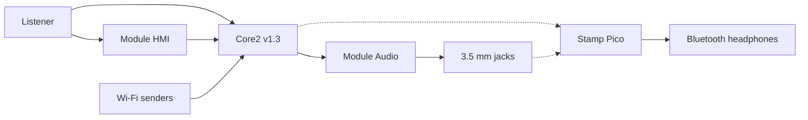

# Architecture

Status: baseline · 2026-10-29

Porta is two controllers. The Core2 v1.3 owns the UI, Wi-Fi, and the analog codec. The M5Stamp Pico owns Bluetooth transmission. They are not on the same module stack. The Stamp Pico sits on a Module Proto and is cabled to the Core2. The cable is [D-0031](decisions.md#d-0031-board-link).

The cable between the Core2 and the Stamp Pico is specified in [D-0031](decisions.md#d-0031-board-link). Phase 1 still builds the two firmwares as separate prototypes ([D-0023](decisions.md#d-0023-separate-phase-1-prototypes)). The line-in path does not run through Spotify.

## Hardware

| Part | Role | Identification |
| --- | --- | --- |
| Core2 v1.3 | Host, screen, Wi-Fi, PMU | ESP32-D0WDQ6-V3, 16 MB flash, 8 MB PSRAM, AXP192, ILI9342C 320×240, FT6336U, NS4168, SPM1423, BMI270, BM8563. [D-0003](decisions.md#d-0003-host-board) |
| Module Audio (M144) | 3.5 mm input and output | ES8388 at I2C `0x10`, controller MCU at `0x33`. TRS is mic only. TRRS is headphone plus mic. [D-0004](decisions.md#d-0004-analog-module) |
| Module HMI | Wheel and buttons | STM32F030, I2C `0x41`. Button 1 is the encoder press, buttons 2 and 3 are the side buttons. [D-0005](decisions.md#d-0005-hmi-module) |
| M5GO Bottom2 v1.3 (A014-C-V13) | Base when modules are stacked | 500 mAh cell, TP4057, BMI270, PDM mic. Replaces the Core2 battery bottom. [D-0006](decisions.md#d-0006-base) |
| M5Stamp Pico | A2DP source | ESP32-PICO-D4, no PSRAM. [D-0007](decisions.md#d-0007-bluetooth-transmitter) |
| Module Proto | Carrier for the Stamp Pico | Custom I2S and control wiring |
| microSD | Present on the Core2 | No phase 1 use. A later config store is still open. [D-0025](decisions.md#d-0025-microsd-in-phase-1), [D-0027](decisions.md#d-0027-microsd-purpose) |

Vendor descriptions used for the identification:

- [Core2 v1.3](https://docs.m5stack.com/en/core/Core2_v1.3)
- [Module Audio](https://docs.m5stack.com/en/module/Module_Audio)
- [Module HMI](https://docs.m5stack.com/en/module/Module_HMI)
- [M5GO Bottom2 v1.3](https://docs.m5stack.com/en/base/Base_M5GO_Bottom2_v1.3)

## Audio paths

**Phase 1 player.** The Core2 is a Spotify Connect speaker ([D-0029](decisions.md#d-0029-spotify-transport)). cspot fetches the track over Wi-Fi, decodes it to PCM, and a Porta I2S sink clocks that PCM into Module Audio. Play, pause, and skip call the same session. The internal NS4168 speaker and SPM1423 microphone are not the product output. They share the codec pins and must be disabled ([P-0006](pitfalls.md#p-0006-internal-i2s)).

**Phase 1 bridge.** A separate firmware on the Stamp Pico takes I2S and sends A2DP. The Postern component offers AAC-LC and falls back to SBC. SBC is the session that has to pass on the board before AAC is treated as done ([P-0003](pitfalls.md#p-0003-no-psram), [P-0024](pitfalls.md#p-0024-aac-source)).

**Phase 2 line bridge.** The ES8388 ADC captures the TRS jack. Samples reach the Stamp Pico by the link in [D-0031](decisions.md#d-0031-board-link).

**Phase 2 network receiver.** AirPlay 1 and DLNA terminate on the Core2 ([D-0036](decisions.md#d-0036-airplay-and-dlna)). AirPlay 1 arrives as ALAC. DLNA arrives as LPCM, WAV PCM, or ALAC. Playback uses the same I2S fan-out as the player: Module Audio and the Stamp Pico.

One clock master drives BCLK and LRCK. The other chips are slaves ([P-0017](pitfalls.md#p-0017-one-clock-master)). The rate is [D-0032](decisions.md#d-0032-i2s-format).

## Pins on Core2 v1.3

M5's Core2 v1.3 audio table wires the NS4168 and the SPM1423 as follows.

| Signal | GPIO | On the M5-Bus |
| --- | --- | --- |
| I2S BCLK | GPIO12 | No |
| I2S LRCK, mic clock | GPIO0 | Pin 24 |
| I2S DOUT to the speaker | GPIO2 | Pin 23 |
| Mic data | GPIO34 | Pin 26 |

GPIO12 is real and it is not brought out on the stack connector. GPIO15 is the LCD DC pin, not an I2S pin. GPIO13 is UART2 RX, not the speaker word clock. A generic M5-Bus drawing that assigns I2S to GPIO12, GPIO13, GPIO15, and GPIO0 does not describe this board ([P-0023](pitfalls.md#p-0023-core2-pin-map)).

The ESP32 GPIO matrix can route I2S0 or I2S1 to other output-capable pins. Input-only GPIO34, GPIO35, GPIO36, and GPIO39 cannot drive BCLK, LRCK, or DOUT.

Leave these alone when adding a second audio port: GPIO0, GPIO2, GPIO12, and GPIO34 (codec), GPIO21 and GPIO22 (internal I2C), GPIO18, GPIO23, GPIO38, GPIO5, GPIO15, and GPIO4 (LCD and microSD), GPIO1 and GPIO3 (USB download), GPIO39 (touch interrupt). GPIO25 is the LED data pin on M5GO Bottom2.

Pins that remain usable for another I2S are GPIO13, GPIO14, GPIO19, GPIO26, and GPIO27. GPIO32 and GPIO33 can also carry I2S, and this design uses them for the external I2C instead. The cable is [D-0031](decisions.md#d-0031-board-link): I2S1 on Core2 GPIO14, GPIO13, and GPIO26, master on the Core2, data toward the Stamp Pico only. The Stamp Pico receives that data on GPIO36, with the clocks on GPIO18 and GPIO19. Those numbers are not the Core2 numbers.

Module Audio's configuration A is the Core2 setting. Its bus drawing places I2S on pins 21–26, which on this host are GPIO27, GPIO19, GPIO2, GPIO0, and GPIO34. Confirm the module's switch before driving those pins. Do not enable the NS4168 at the same time ([P-0006](pitfalls.md#p-0006-internal-i2s)).

## Control

Module HMI and Module Audio sit on the Core2 I2C bus. Known addresses: HMI `0x41`, audio MCU `0x33`, ES8388 `0x10`, AXP192 `0x34`, FT6336U `0x38`, BM8563 `0x51`. Re-scan the assembled stack before adding a device ([P-0007](pitfalls.md#p-0007-i2c-map)).

The UI architecture is the action API in [ui design](ui-design.md). How that API sits among the Core2 components is [software](software.md).

## Power

Stacking modules requires the Core2 battery bottom to come off. M5 documents that a Core2 v1.3 must not sit on a Base-series base, and that M5GO Bottom2 is the base that keeps a battery in that configuration ([P-0004](pitfalls.md#p-0004-stack-mechanics)). The HMI module also contains a 500 mAh cell. Those cells are not one battery ([P-0005](pitfalls.md#p-0005-parallel-cells)). Which cell is charged, which is measured, and how the rail survives a Wi-Fi association plus I2S is [D-0033](decisions.md#d-0033-power-architecture).

## Software boundary

The Core2 application is one ESP-IDF image ([D-0028](decisions.md#d-0028-firmware-framework)). Its components are [software](software.md) ([D-0042](decisions.md#d-0042-core2-components)). The tree is `firmware/` ([D-0043](decisions.md#d-0043-firmware-tree)). `idf.py` is in the development shell. The Stamp Pico bridge is the Postern submodule, an ESP-IDF component whose pins are compile-time Kconfig on that chip ([D-0039](decisions.md#d-0039-firmware-repos)). See [operations](operations.md).
