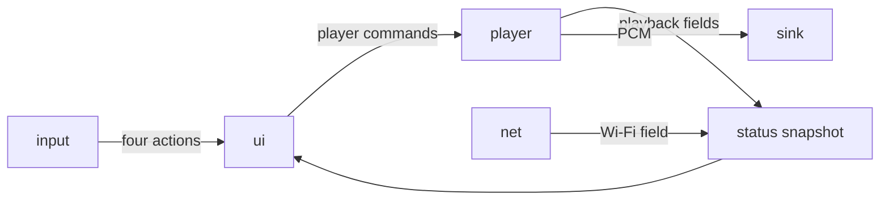

# Software

Status: baseline · 2026-10-31

The Core2 application is one Rust image on ESP-IDF v5.5.6 ([D-0046](decisions.md#d-0046-core2-language), [D-0042](decisions.md#d-0042-core2-components)). The tree is `firmware/` ([D-0043](decisions.md#d-0043-firmware-tree)). The modules live in `firmware/src`. This page names them and what crosses between them. Pins stay in [architecture](architecture.md). Listener actions stay in [ui design](ui-design.md).

The panel and the player share that image. Their seam is a set of player commands and one status snapshot. PCM does not cross the seam. cspot is the part that needs the Core2's 8 MB PSRAM ([D-0029](decisions.md#d-0029-spotify-transport)). Its task stacks stay there ([P-0064](pitfalls.md#p-0064-cspot-task-stack)). The panel draws its own color blocks ([D-0011](decisions.md#d-0011-visual-language)). The renderer keeps one 320×240 frame, 150 KB, in PSRAM. SPI3 on this ESP32 cannot DMA from PSRAM, so a paint copies that frame out in internal DMA bands ([P-0053](pitfalls.md#p-0053-panel-frame)).

## Components

| Component | Phase | Scope |
| --- | --- | --- |
| `seam` | 1 | Command, snapshot, and queue declarations. No driver and no task. The queue holds eight commands. |
| `app` | 1 | Starts the others, owns the snapshot and the command queue, and runs the two steps. Holds no screen rules and no codec registers. `firmware_main` calls `App::init`, then the panel supply, and polls the HMI and the touch controller. |
| `input` | 1 | Module HMI at I2C `0x41`, the FT6336U, and the three virtual screen buttons. Emits next, previous, activate, and back. Also reports BtnB and screen-button presses. A tap on a focused block reports which third was hit. Leaves the HMI LEDs off. Does not draw. |
| `ui` | 1 | Screen stack, focus index, and the phase 1 screens: Now Playing, Connect, and Settings. Draws on the ILI9342C. Consumes actions. Emits a player command only for a focused playback block. Reads the snapshot. Drops BtnB ([D-0026](decisions.md#d-0026-second-hmi-button)). Drops screen buttons until a label exists ([D-0034](decisions.md#d-0034-screen-buttons)). |
| `player` | 1 | Accepts play, pause, next, previous, and set volume. A session is a stored credential blob plus Wi-Fi. It then takes a track title and PCM, and the same commands are handed to that session. With no blob, the source is the labelled tone stand-in ([P-0001](pitfalls.md#p-0001-spotify-on-the-esp32)). This image links cspot. It stores a session marker after Zeroconf. The real blob stays inside cspot. |
| `sink` | 1 | Accepts 16-bit stereo PCM at 44100 or 48000 Hz and resamples between those two rates ([D-0032](decisions.md#d-0032-i2s-format)). `Board::limit_measured` stays false until the AXP192 limit is written down. That does not block hardware I2S ([P-0040](pitfalls.md#p-0040-unmeasured-rail), [P-0006](pitfalls.md#p-0006-internal-i2s)). |
| `net` | 1 | Writes the Wi-Fi field of the snapshot. The station tries the bench SSIDs from `.env` in order ([P-0058](pitfalls.md#p-0058-cspot-credentials)). `join` calls `esp_wifi_init` with the IDF task stack before `EspWifi::new`, which leaves that size at 0 ([P-0062](pitfalls.md#p-0062-wi-fi-task-memory)). Starting it before the current limit is measured is allowed ([P-0040](pitfalls.md#p-0040-unmeasured-rail)). The station hostname is the DNS label of the Connect name, set before the lease. Spaces become hyphens. The `_spotify-connect._tcp` announcement uses that label as the mDNS hostname and the Connect name as the instance ([P-0065](pitfalls.md#p-0065-connect-announcement)). |
| `board` | 1 | Internal I2C, the pin map in [architecture](architecture.md), and the AXP192 current limit ([NFR-04](requirements.md)). Enables the panel logic supply, the backlight, and M-Bus 5 V for the Module HMI ([P-0055](pitfalls.md#p-0055-mbus-5v)). Does not mount the microSD slot ([D-0025](decisions.md#d-0025-microsd-in-phase-1), [P-0046](pitfalls.md#p-0046-lcd-rail-and-the-microsd-slot)). Does not measure a cell until [D-0033](decisions.md#d-0033-power-architecture) closes. |

`app` may call the others. The others do not include `app`. The command and snapshot types live in `seam` and contain no drivers. `ui` does not include cspot, the ES8388, I2S, or the Wi-Fi driver ([P-0038](pitfalls.md#p-0038-panel-calls-the-player)). `player`'s public surface is the commands, the playback fields, and the calls that send and read them. `app` passes the current block rectangles into `input`.

## Interactions

**Actions.** `input` delivers them to `ui` only. Focus, back, and the stack stay in `ui`. BtnB and unbound screen buttons stay there too. In one poll, button and touch actions come before wheel steps, so a press confirms the block that already has focus. Wheel steps that do not fit stay pending. One click is four encoder counts and one focus step ([P-0057](pitfalls.md#p-0057-encoder-counts)). A rising edge stays armed when the action list is full. A volume step is sent only when the value changes, and only when the queue accepts it.

**Player commands.** `ui` sends play, pause, next, previous, and set volume ([D-0029](decisions.md#d-0029-spotify-transport)). Wheel next and previous move focus. Now Playing has one transport block and one volume block. The transport word is Play or Pause. Its left third sends previous and its right third sends next. The volume word is `vol` and the level. Its left third is quieter and its right third is louder, ten steps at a time, clamped to 0..100. The wheel press and the middle third run the block: play or pause on transport, and no step on the volume block. There is no volume line under the title. Play, Pause, previous, and next are sent only while the session is ready. A tap on an unfocused block is a focus action so the finger can name that block; it is still the same focus index. Zeroconf and stored credentials stay in `player` ([D-0030](decisions.md#d-0030-login)). The blob is held in RAM. Until a blob is stored and Wi-Fi is up, the snapshot title is "Tone stand-in" and the session is not ready. The painted headline is "Wi-Fi down" until the station has an address, then "Pick " plus the device name from `.env` (that name is `porta` when the key is empty) until Zeroconf. The Connect screen's second line follows that, and becomes the track once the session is ready. This image stores a session marker after Zeroconf ([P-0001](pitfalls.md#p-0001-spotify-on-the-esp32), [P-0058](pitfalls.md#p-0058-cspot-credentials)). A failed access-point read is tried three times and then the task waits for another login ([P-0067](pitfalls.md#p-0067-civetweb-thread-argument)).

**Status snapshot.** One fixed-size record, replaced as a whole. Phase 1 fields are a short title, playing or paused, volume, session ready, and Wi-Fi associated. `app` holds the record. `player` and `net` write their fields. `ui` copies it before drawing.

**PCM.** `player` hands 16-bit stereo frames to `sink`. `sink` clocks them into Module Audio. This path does not enter the snapshot. This image's sink does not clock I2S ([P-0060](pitfalls.md#p-0060-cspot-image-link)).

**Startup.** `App::init` calls `board` before the steps run. `firmware_main` enables the panel rails, switches M-Bus 5 V, paints "Joining Wi-Fi", joins the bench station, paints the result, then reads the HMI and the FT6336U on that same I2C driver. It repaints when an action lands and when the association, the session, or the title changes. Hardware I2S is still off. Starting it before the current limit is measured is allowed ([P-0040](pitfalls.md#p-0040-unmeasured-rail)). A wheel tick does not pass through `board`.

## Tasks

`App::panel_step` runs `input` and `ui`. `App::audio_step` runs `player` and the software `sink`. `join` writes the Wi-Fi field after the station has an address ([P-0061](pitfalls.md#p-0061-station-association)). A failed attempt is released with a two-second poll ([P-0063](pitfalls.md#p-0063-wi-fi-release-wait)). The steps share the command queue and the snapshot. FreeRTOS priorities and core pinning wait until a build is measured.

## Later seams

These pieces stay out of the phase 1 image ([D-0023](decisions.md#d-0023-separate-phase-1-prototypes), [P-0012](pitfalls.md#p-0012-phase-creep)).

| Later piece | Phase | How it meets the phase 1 seam |
| --- | --- | --- |
| Cable output | 2 | Added inside `sink`: the second I2S and Postern's register file, rate, start, stop, connect, and remove ([D-0031](decisions.md#d-0031-board-link)). `ui` does not address the Stamp Pico. |
| Line input | 2 | PCM from the ES8388 ADC into `sink`. Auxiliary mode is a source choice on the existing actions. |
| Power level | 2 | `board` fills it after [D-0033](decisions.md#d-0033-power-architecture) names the cell. `ui` displays the snapshot. |
| Panel sleep | 2 | `ui` asks `board` to turn the LCD off after idle time. `player` and `sink` keep running. An input action turns the panel on again ([UC-10](use-cases.md#uc-10-wake-a-dark-panel)). |
| Module Audio status LEDs | 2 | The snapshot gains the active source. `board` writes the audio MCU at I2C `0x33` from that field ([D-0047](decisions.md#d-0047-module-audio-leds)). `ui` does not address that MCU. Idle, Spotify, and the TRS source are this phase. The blue AirPlay and DLNA pattern is the same write once those sources exist. |
| AirPlay 1 source, DLNA source | 3 | Each is its own component. PCM goes to `sink`. Snapshot fields are filled where the source has them. Transport commands are accepted where the source has them. |
| Auto power-off | 3 | `board` stops playback and powers off at the low threshold ([UC-08](use-cases.md#uc-08-stop-before-the-battery-dies)). |

New screens use the same four actions ([FR-12](requirements.md)).

## Left open

Task priorities, stack sizes, and the ES8388 register sequence. `Board::limit_measured` stays false until the AXP192 limit is written down, and that does not block I2S or Wi-Fi ([P-0040](pitfalls.md#p-0040-unmeasured-rail)). The Rust module names are the component names above. Panel power and the ILI9342C paint are `board_panel` and `ui_lcd`, compiled only for the ESP-IDF target. The host test does not link them.
