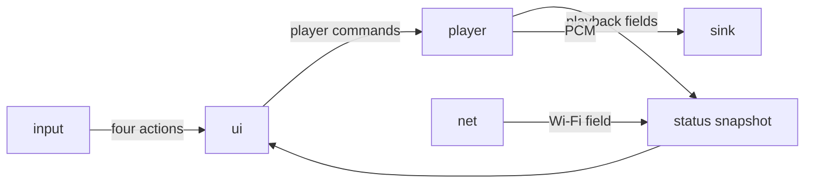

# Software

Status: baseline · 2026-10-29

The Core2 application is one ESP-IDF image ([D-0028](decisions.md#d-0028-firmware-framework), [D-0042](decisions.md#d-0042-core2-components)). Phase 0 does not add the tree ([D-0021](decisions.md#d-0021-no-firmware-tree)). This page names the components and what crosses between them. It does not name C types, queue depths, task priorities, or pins. Pins stay in [architecture](architecture.md). Listener actions stay in [ui design](ui-design.md).

The panel and the player share that image. Their seam is a set of player commands and one status snapshot. PCM does not cross the seam. cspot is the part that needs the Core2's 8 MB PSRAM ([D-0029](decisions.md#d-0029-spotify-transport)). The panel draws its own color blocks ([D-0011](decisions.md#d-0011-visual-language)). A stored 320×240 frame at 16 bits per pixel is 150 KB and belongs in PSRAM when the renderer keeps one.

## Components

| Component | Phase | Scope |
| --- | --- | --- |
| `app` | 1 | Starts the others, owns the snapshot and the command queue, and runs the two tasks. Holds no screen rules and no codec registers. |
| `input` | 1 | Module HMI at I2C `0x41`, the FT6336U, and the three virtual screen buttons. Emits next, previous, activate, and back. Also reports button index 3 and screen-button presses. Leaves the HMI LEDs off. Does not draw. |
| `ui` | 1 | Screen stack, focus index, and the phase 1 screens: Now Playing, Connect, and Settings. Draws on the ILI9342C. Consumes actions. Emits a player command only for a focused playback block. Reads the snapshot. Drops button index 3 ([D-0026](decisions.md#d-0026-second-hmi-button)). Drops screen buttons until a label exists ([D-0034](decisions.md#d-0034-screen-buttons)). |
| `player` | 1 | The Connect session through cspot. Accepts play, pause, next, previous, and set volume. Fills title, transport, volume, and session-ready. Pushes PCM to `sink`. A labelled tone may stand in before cspot is linked ([P-0001](pitfalls.md#p-0001-spotify-on-the-esp32)). |
| `sink` | 1 | The only I2S clock master. ES8388 headphone path. The internal NS4168 and SPM1423 stay disabled ([P-0006](pitfalls.md#p-0006-internal-i2s)). Accepts 16-bit stereo PCM. Resamples when the output rate is not the source rate ([D-0032](decisions.md#d-0032-i2s-format)). Phase 1 output is the jack. |
| `net` | 1 | Wi-Fi station on the Core2. Fills the association field. `player` uses that station. |
| `board` | 1 | Internal I2C, the pin map in [architecture](architecture.md), and the AXP192 current limit ([NFR-04](requirements.md)). Does not mount the microSD slot ([D-0025](decisions.md#d-0025-microsd-in-phase-1)). Does not measure a cell until [D-0033](decisions.md#d-0033-power-architecture) closes. |

`app` may call the others. The others do not include `app`. The command and snapshot types are declarations with no drivers. `ui` includes those declarations and the public header of `input`. It does not include cspot, the ES8388, I2S, or the Wi-Fi driver ([P-0038](pitfalls.md#p-0038-panel-calls-the-player)). `player`'s public header is the commands, the playback fields, and the calls that send and read them.

## Interactions

**Actions.** `input` delivers them to `ui` only. Focus, back, and the stack stay in `ui`. Button index 3 and unbound screen buttons stay there too.

**Player commands.** `ui` sends play, pause, next, previous, and set volume ([D-0029](decisions.md#d-0029-spotify-transport)). While the volume block is focused, `ui` maps the shared actions onto set volume. That mapping stays inside the four actions ([UC-01](use-cases.md)). Zeroconf and stored credentials stay in `player` ([D-0030](decisions.md#d-0030-login)). The Connect screen reads the result from the snapshot.

**Status snapshot.** One fixed-size record, replaced as a whole. Phase 1 fields are a short title, playing or paused, volume, session ready, and Wi-Fi associated. `app` holds the record. `player` and `net` write their fields. `ui` copies it before drawing.

**PCM.** `player` hands 16-bit stereo frames to `sink`. `sink` clocks them into Module Audio. This path does not enter the snapshot.

**Startup.** `app` calls `board` before the tasks run. A wheel tick does not pass through `board`.

## Tasks

The panel task runs `input` and `ui`. The audio task runs `player` and `sink`. Station events update the Wi-Fi field. The tasks share the command queue and the snapshot. Priorities and core pinning wait until a build is measured.

## Phase 2 seams

These pieces stay out of the phase 1 image ([D-0023](decisions.md#d-0023-separate-phase-1-prototypes), [P-0012](pitfalls.md#p-0012-phase-creep)).

| Later piece | How it meets the phase 1 seam |
| --- | --- |
| AirPlay 1 source, DLNA source | Each is its own component. PCM goes to `sink`. Snapshot fields are filled where the source has them. Transport commands are accepted where the source has them. |
| Line input | PCM from the ES8388 ADC into `sink`. Auxiliary mode is a source choice on the existing actions. |
| Cable output | Added inside `sink`: the second I2S and Postern's register file, rate, start, stop, and link status ([D-0031](decisions.md#d-0031-board-link)). `ui` does not address the Stamp Pico. |
| Battery field | `board` fills it after [D-0033](decisions.md#d-0033-power-architecture) names the cell. `ui` displays the snapshot. |

New screens use the same four actions ([FR-12](requirements.md)).

## Left open

C structs, function names, queue lengths, and stack sizes. The directory layout arrives with the first firmware change. The directory names are these component names.
